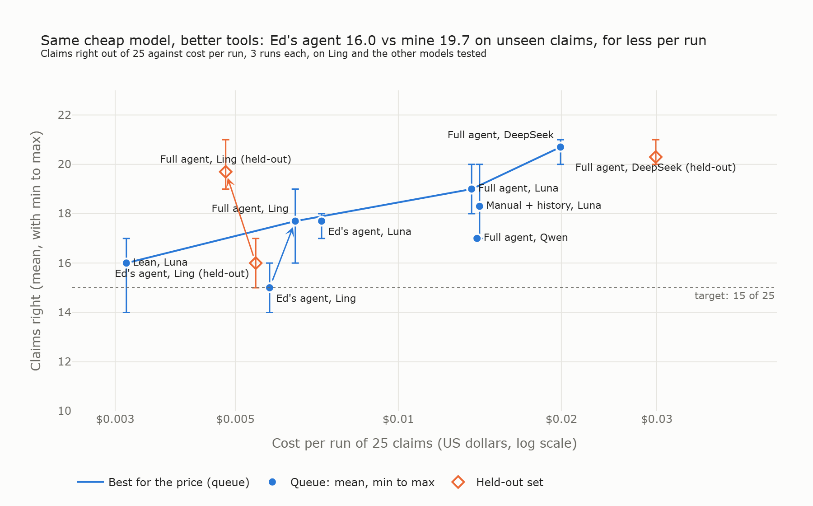

# Week 1 Day 2: autonomy where it's needed, code where it isn't

Okafor Pascal

**Cheapest model that gets at least 15 of 25 right in every run:** `inclusionai/ling-3.0-flash` with my agent, at **$0.0065 a run** of 25 claims (16, 18 and 19 right on the queue; 21, 19 and 19 on the held-out set, at $0.0048 a run).

**Most accurate:** `deepseek/deepseek-v4-flash-0731` with my agent: 20, 21 and 21 on the queue at $0.020 a run, and 20, 20 and 21 on the held-out set at $0.030 a run.

**Same model, better tools.** On `ling-3.0-flash`, Ed's agent gets 14, 16 and 15 on the queue and misses the target; mine gets 16, 18 and 19. On the held-out set, Ed's gets 17, 15 and 16 and mine gets 21, 19 and 19, for about the same cost a run.

## The design

Ed's agent spends model calls on steps that need no judgment, and leaves the arithmetic to the model. Mine moves those steps into code:

1. **No fake autonomy.** The policy record is in the prompt instead of behind a `get_policy` call. Recording the decision ends the run with no closing message: a `before_model` middleware stops the agent once a decision is on file. (`return_direct=True` also works in LangChain 1.4, but it ends the run even when `record_decision` refuses, so it doesn't suit the rule below.)
2. **Tools the agent chooses when it needs them.** `get_claim_history` returns the customer's earlier claims, with the 12-month count done in code and none of their contact details. `search_claims_manual` and `read_manual_section` read `data/claims_manual.md`. The search is a plain BM25 ranking over all 14 sections with a light suffix stemmer. It has no keyword list and nothing chosen because of failing claims.
3. **Code does the arithmetic.** `calculate_payout` wraps `work_out_payout` from Ed's `labs/week2day1_payout.py`, so the model only classifies the lines. `record_decision` refuses `approve` until `calculate_payout` has run on the claim, and records the payout the code worked out.
4. **The agent never sees `data/evals/`.** The labels are used only for scoring, and an offline check scans every agent-facing function and prompt for them.

Every configuration ran 3 times, with a step budget of 10 model calls a claim. Total spend: $0.47.

## Results on the queue

| Configuration | Model | Min | Mean | Max | Cost per run | Cost per correct | Seconds per claim |
|---|---|---|---|---|---|---|---|
| Ed's agent | Luna low | 17 | 17.7 | 18 | $0.0072 | $0.00041 | 7.3 |
| A: lean, v1 | Luna low | 13 | 13.3 | 14 | $0.0028 | $0.00021 | 2.3 |
| B: + manual and history, v1 | Luna low | 15 | 15.3 | 16 | $0.0130 | $0.00085 | 8.0 |
| C: + payout tool, v1 | Luna low | 18 | 19.7 | 21 | $0.0132 | $0.00067 | 8.0 |
| A: lean, v2 | Luna low | 14 | 16.0 | 17 | $0.0031 | $0.00020 | 2.7 |
| B: + manual and history, v2 | Luna low | 17 | 18.3 | 20 | $0.0141 | $0.00077 | 8.9 |
| C: full agent, v2 | Luna low | 18 | 19.0 | 20 | $0.0137 | $0.00072 | 8.6 |
| Full agent | DeepSeek V4 Flash | 20 | 20.7 | 21 | $0.0199 | $0.00096 | 11.2 |
| Full agent | Ling 3.0 Flash | 16 | 17.7 | 19 | $0.0065 | $0.00037 | 14.8 |
| Ed's agent | Ling 3.0 Flash | 14 | 15.0 | 16 | $0.0058 | $0.00039 | 11.3 |
| Full agent | Qwen 3.7 Flash | 17 | 17.0 | 17 | $0.0140 | $0.00082 | 31.9 |
| Full agent | gpt-oss-20b | 4 | 4 | 4 | $0.0010 | | 1 run |
| Full agent | Mistral Nemo | 0 | 0 | 0 | $0.0029 | | 1 run |

The sweep took OpenRouter's tool-capable models, left out `:batch` and `~` aliases, and ranked them by estimated cost a claim. It then ran the five cheapest and three free ones. A model with fewer than 10 right on its first run stopped there. `results.csv` has every configuration, with misses by difficulty and by kind.

## Held-out set

Chosen before the run, with the same code and prompts and no changes afterwards.

| Configuration | Min | Mean | Max | Cost per run | Cost per correct | Seconds per claim |
|---|---|---|---|---|---|---|
| Full agent, Ling 3.0 Flash | 19 | 19.7 | 21 | $0.0048 | $0.00024 | 7.3 |
| Ed's agent, Ling 3.0 Flash | 15 | 16.0 | 17 | $0.0055 | $0.00034 | 10.4 |
| Full agent, DeepSeek V4 Flash | 20 | 20.3 | 21 | $0.0299 | $0.00147 | 14.1 |

## Findings

- **Each lever, one at a time (v1).** Putting the policy in the prompt and stopping on record cut the calls from 3 a claim to 1, and the cost by 60%, but lost 4.4 claims a run. The manual and history tools won back 2.0, and the payout tool another 4.4 for almost nothing.
- **Why v1's lean agent got worse.** v1's `record_decision` asked for the decision and payout before the rationale. With one call, the model committed first and reasoned afterwards. On CLM-1013 it wrote "exceeding the 12-hour waiting period? Actually it does not, so the claim is not eligible" and recorded approve $64. In Ed's agent, the `get_policy` turn came before the decision and was acting as thinking time. v2 asks for the rationale first, as the lab does for Structured Outputs, and lifts the lean agent from 13.3 to 16.0. v1 is kept in the results as it ran.
- **Cheap models make fewer tool calls.** Ling averaged 2.2 model calls a claim against Luna's 4.1. Over 75 claims it called `get_claim_history` 16 times (Luna 74) and never called `read_manual_section` (Luna 63). Most of its misses come from that.
- **gpt-oss-20b and Mistral Nemo don't call tools here.** They mostly answered in plain text instead of calling `record_decision`, so they can't do this job at any price.
- **The free models are untested.** In the sweep, `openrouter/free`, `nemotron-3-super-120b-a12b:free` and `gemma-4-31b-it:free` failed 132 of their 150 claims with OpenRouter's 429 error. A paced retest followed, with one claim at a time, 12 calls a minute and a backoff of up to 240 seconds, on `openrouter/free`, `nemotron-3.5-lightning:free` and `gemma-4-31b-it:free`. All three were still refused on the first claim. The error was OpenRouter's `free-models-per-day` limit: 50 requests a day on this account, already used up. One run of 25 claims needs about 100 calls, so measuring a free model needs the 1,000-a-day allowance. Their zeros say nothing about the models, and $0 can't be the answer until they are measured.

## What the final configuration still gets wrong

The full agent on Ling 3.0 Flash. The number in brackets is how many of its 3 runs missed the claim.

**Queue**

- Routine
  - CLM-1002 (3): refers for missing proof of value. The four shirts are $30 each, and items of $100 or less need only the customer's list. The handler approved $580.
  - CLM-1001 (1): ended without recording a decision.
- Hard
  - CLM-1023, CLM-1025 (3 each): approves a trip delay where the carrier's letter leaves out the cause. The required document is incomplete, so the handler referred.
  - CLM-1011 (2): wrong payout. Two sets split across lines count as one item each.
  - CLM-1021 (1): wrong payout. Electronics Plus covers a closed list of devices.
- Manual
  - CLM-1018 (3): approves without proof of value for items over $100 (manual section 5).
  - CLM-1019 (3): misses the third claim in 12 months, which needs the history (manual section 9).
  - CLM-1024 (3): misses that the same loss was already claimed and paid, which needs the history.

**Held-out set**

- Routine
  - CLM-1122 (1): declines where the story and the documents conflict, which calls for a referral.
- Hard
  - CLM-1108, CLM-1123 (3 each): the same incomplete carrier letter, with the cause left out.
  - CLM-1103, CLM-1118 (1 each): wrong payout. Several items on one line, and a set split over two lines.
- Manual
  - CLM-1116 (3): the same loss already claimed and paid.
  - CLM-1125 (3): the third claim in 12 months, counting a declined claim.
  - CLM-1106 (1): declines a loss to a wild animal as a theft with no police report.

It misses ten claims in every run across the two sets. Four of them (CLM-1019, CLM-1024, CLM-1116, CLM-1125) need the claim history, which this model rarely looks up.

## Running it

The notebook is `week1day2_okafor.ipynb` and runs from this folder on the course's `.venv`. Each run is cached to `results/`, which is not in this PR, so a fresh run makes paid calls. Set `RUN_PAID = True`. `BUDGET` stops it at $3, and the whole notebook cost $0.47. Writing `results.png` needs kaleido, for example `uv run --with kaleido jupyter lab`.

Credit: the payout rules are Ed Donner's `labs/week2day1_payout.py`, used unchanged.
